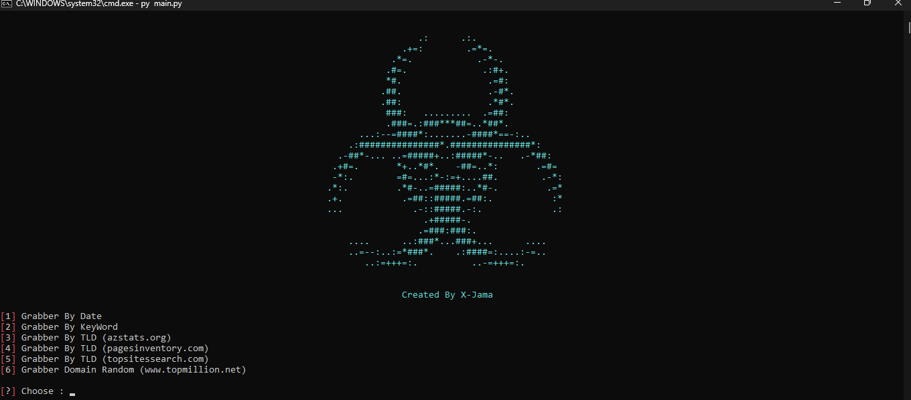
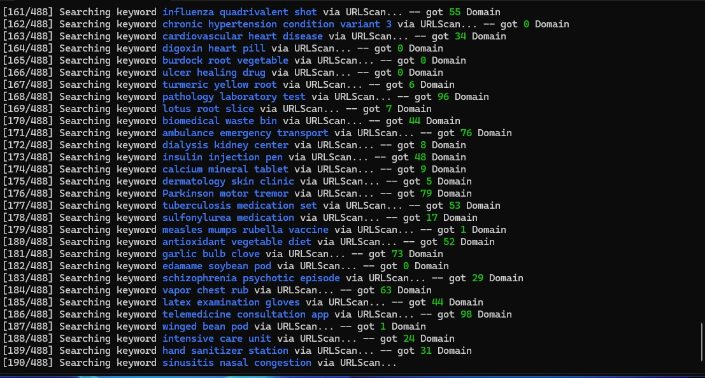

# DGrab

Command-line tool Python untuk mengumpulkan domain dari sumber publik berdasarkan tanggal, keyword, TLD, atau daftar situs populer.

> Gunakan DGrab hanya untuk data publik dan aktivitas yang memiliki izin.

## Tampilan

### Menu utama



### Contoh pencarian



## Fitur utama

- Banner ASCII ditampilkan di tengah terminal.
- Pencarian berdasarkan rentang tanggal melalui CubDomain.
- Pencarian berdasarkan keyword melalui URLScan.
- Pencarian domain berdasarkan satu atau beberapa TLD.
- Pengambilan domain dari halaman TopMillion secara otomatis.
- Deduplikasi domain secara otomatis.
- Proxy opsional untuk menu keyword, termasuk rotasi proxy ketika menerima `429`.
- File keyword dan proxy dipilih melalui dialog file Windows.

## Persyaratan

- Python 3.8 atau lebih baru.
- Koneksi internet.
- Tkinter, untuk dialog pemilihan file.
- `requests`.
- `colorama`.
- Dukungan SOCKS memerlukan `requests[socks]`.

## Instalasi

Buka PowerShell pada folder project:

```powershell
cd D:\Dgrab
```

Buat virtual environment jika diperlukan:

```powershell
python -m venv .venv
.venv\Scripts\Activate.ps1
```

Install dependency:

```powershell
pip install -r require.txt
```

Untuk dukungan proxy SOCKS :

```powershell
pip install "requests[socks]"
```

## Menjalankan

```powershell
python main.py
```

Menu yang tersedia:

```text
[1] Grabber By Date
[2] Grabber By KeyWord
[3] Grabber By TLD (azstats.org)
[4] Grabber By TLD (pagesinventory.com)
[5] Grabber By TLD (topsitessearch.com)
[6] Grabber Domain Random (www.topmillion.net)
```

## Penggunaan

### 1. Grabber By Date

Pilih menu `1`, kemudian masukkan tanggal awal dan akhir dengan format `YYYY-mm-dd`.

```text
From Date: 2025-01-01
To Date: 2025-01-03
```

Tanggal awal tidak boleh lebih besar daripada tanggal akhir. Tool mengambil halaman tanggal terlebih dahulu, kemudian mengambil domain dari halaman yang ditemukan.

### 2. Grabber By Keyword

Pilih menu `2`. Dialog file akan terbuka otomatis. Pilih file teks dengan satu keyword pada setiap baris:

```text
shop
news
technology
gaming
```

Baris kosong diabaikan. Satu keyword dikirim sebagai satu query URLScan, bukan satu request untuk setiap kata di dalam keyword. Progress ditampilkan dengan format:

```text
[1/4] Searching keyword shop via URLScan...
```

#### Pilihan proxy

Sebelum pencarian dimulai, tool menanyakan:

```text
Use proxy? (y/n):
```

Pilih `n` untuk koneksi langsung. Pilih `y` untuk membuka dialog pemilihan file proxy. Isi file proxy satu alamat per baris:

```text
http://127.0.0.1:8080
https://127.0.0.1:3128
socks5://127.0.0.1:9050
```

Alamat tanpa skema juga diterima dan dianggap sebagai proxy HTTP:

```text
127.0.0.1:8080
```

Proxy digunakan bergantian. Jika proxy aktif menerima status `429`, tool langsung mencoba proxy berikutnya untuk request yang sama. Jika seluruh proxy terkena rate limit, tool menunggu maksimal 60 detik sebelum melanjutkan ke keyword berikutnya. Tanpa proxy, URLScan yang mengembalikan `429` juga dapat menyebabkan jeda sebelum proses dilanjutkan.

> Catatan: proxy harus dapat digunakan dan memiliki akses internet. Proxy yang lambat, mati, atau menolak HTTPS dapat menghasilkan timeout atau `ConnectionError`.

### 3. Grabber By TLD — azstats.org

Pilih menu `3`, lalu masukkan satu atau beberapa TLD yang dipisahkan koma:

```text
com,net,co,us
```

Titik di depan TLD boleh digunakan, tetapi akan dihapus otomatis. Jika sumber utama gagal atau tidak menghasilkan domain, tool mencoba fallback Certificate Transparency melalui `crt.sh`.

### 4. Grabber By TLD — pagesinventory.com

Pilih menu `4`, lalu masukkan TLD dengan format yang sama:

```text
com,net,org
```

Sumber lama dapat melakukan redirect, mengembalikan `403`, atau tidak lagi menyediakan struktur halaman yang diharapkan. Jika memungkinkan, tool mencoba fallback `crt.sh` dan menampilkan error sumber secara terpisah.

### 5. Grabber By TLD — topsitessearch.com

Pilih menu `5`, lalu masukkan TLD dan jumlah halaman:

```text
TLD Domain: com,net,org
Total Page: 10
```

Semua TLD diproses untuk jumlah halaman yang dipilih. Menu ini menggunakan jumlah worker yang lebih rendah untuk mengurangi risiko pembatasan sumber. Link yang sama tidak disimpan berulang kali.

### 6. Grabber Domain Random

Pilih menu `6`. Tool mengambil daftar halaman dari TopMillion, lalu mengambil domain dari setiap halaman secara otomatis.

## Deduplikasi Domain

Semua hasil dinormalisasi sebelum disimpan:

- Huruf besar diubah menjadi huruf kecil.
- Skema `http://` dan `https://` dihapus.
- Path, query, fragment, dan titik terakhir dihapus.
- Domain yang sama di dalam response tidak ditulis berulang.
- Domain yang sudah ada di file hasil tidak ditambahkan kembali.

Contoh berikut dianggap sama:

```text
Example.COM
https://example.com/path
example.com.
```

Hasilnya hanya disimpan sebagai:

```text
example.com
```

## File Output

Folder `Result` dibuat otomatis ketika program dijalankan.

| File | Menu |
|---|---|
| `Result/cubdomain_bydate.txt` | Menu 1 |
| `Result/domain_keyword.txt` | Menu 2 |
| `Result/grab_tld.txt` | Menu 3, 4, dan 5 |
| `Result/Random-Domain.txt` | Menu 6 |

File hasil dipertahankan dan domain baru ditambahkan ke file yang sama. Deduplikasi juga membaca isi file lama. Untuk memulai dari kosong, buat backup lalu hapus file hasil yang sesuai sebelum menjalankan menu.

## Troubleshooting

### `ModuleNotFoundError`

Install dependency:

```powershell
pip install -r require.txt
```

Jika menggunakan SOCKS:

```powershell
pip install "requests[socks]"
```

### Dialog file tidak muncul

Pastikan Python dipasang bersama komponen Tkinter/Tcl-Tk. Pada Windows, gunakan installer Python resmi dan pastikan komponen tersebut ikut dipasang.

### Banyak `0 domain`

Kemungkinan penyebab:

- Sumber sedang tidak tersedia.
- Sumber mengembalikan `403`, `429`, atau `502`.
- Struktur HTML sumber berubah.
- TLD atau keyword tidak menghasilkan data.
- Request timeout atau proxy tidak dapat terhubung.

Tool menampilkan status error di terminal. Jangan mengulang request secara agresif ketika sumber sedang membatasi akses.

### `429 Too Many Requests`

Untuk menu keyword:

- Dengan proxy, tool mencoba proxy berikutnya secara otomatis.
- Jika semua proxy terkena rate limit, tool menunggu dan kemudian melanjutkan.
- Tanpa proxy, tunggu sampai batas rate limit sumber berkurang.
- Kurangi jumlah keyword atau jalankan file keyword secara bertahap.

### File output belum ada

File output hanya dibuat setelah ada domain yang berhasil ditemukan. Hasil `0` tidak menyebabkan program crash.

## Catatan penggunaan

Gunakan tool hanya untuk data publik dan aktivitas yang memiliki izin. Patuhi hukum, Terms of Service, robots.txt, rate limit, serta kebijakan privasi setiap sumber.

Jangan gunakan tool untuk mengakses sistem tanpa izin, membanjiri layanan, mengirim spam, atau menghindari kontrol akses.

## Lisensi

Project ini menggunakan [MIT License](./LICENSE). Copyright (c) 2026 X-Jama.

Lisensi MIT mengizinkan penggunaan, penyalinan, modifikasi, distribusi,
sublicensing, dan penjualan software dengan syarat pemberitahuan copyright dan
teks lisensi tetap disertakan. Software disediakan tanpa jaminan.

## Panduan kontribusi

Perubahan sebaiknya tetap menjaga:

- penggunaan hanya untuk data publik dan aktivitas yang berizin;
- kepatuhan terhadap rate limit dan Terms of Service sumber;
- deduplikasi hasil;
- dokumentasi yang sesuai dengan perilaku aktual tool;
- validasi syntax sebelum perubahan dikirim.
